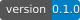

# weBrew

<p align="center">
  
</p>

<p align="center">
  <em>Nine portable Agent Skills for the software lifecycle. From a rough idea to reviewed, verified, archived delivery.</em>
</p>

<p align="center">
  
  
  
  
  <br/>
  
</p>

---

## Why weBrew

Agents write code fast. They also skip the parts that make software *trustworthy*:

- agreeing what "done" actually means
- reviewing the plan **before** building it
- proving the change works
- leaving a record someone else can follow

The result? A lot of motion. Very little confidence. Work that can't be checked, decisions nobody wrote down, tests that were never run, and a diff that looks finished until it meets production.

**weBrew puts those parts back.**

It's not a framework, a runtime, or a CLI. Each skill is a short, self-contained instruction set an agent loads when the task matches. Used alone, a skill fixes one habit. Used together, they form a workflow that produces work you can inspect, challenge, and hand over.

---

## What makes weBrew different

| ✨ | Trait | What it means |
|---|---|---|
| 🎯 | **Plain Markdown** | A skill is a directory with a `SKILL.md`. Nothing to compile, nothing to run. |
| 🧩 | **Self-contained** | No shared library, no cross-skill imports, no dependency graph. |
| 🎒 | **Portable** | Copy or symlink into any host that speaks Agent Skills. |
| 📝 | **Reports first** | Review, diagnosis, and status skills *never edit*. They report. |
| 📋 | **Spec-driven** | One spec per feature, broken into work units with scope and acceptance. |
| 🛡️ | **Approval-gated** | Destructive actions need a preview and an explicit yes. |
| 🤝 | **Human owns delivery** | Agents may commit. Merge, push, release, archive — you decide. |

---

## The workflow

```
IDEA → 🔥 Grill Ideas to Specs → 🔍 Review the Specs → 🏗️ Build the Specs
                                                      ↓
                        ✨ QUALITY LOOP (cycle as needed)
              ┌──────────────┐  ┌──────────────┐  ┌────────────────┐
              │ 🧭 Audit &   │  │ 🧪 Test &    │  │ 🎯 Assure      │
              │    Refine    │  │    Verify    │  │    Quality     │
              │  map→rank→   │  │  risk matrix │  │  coordinates   │
              │  cleanups    │  │  → evidence  │  │  independent   │
              └──────────────┘  └──────────────┘  └────────────────┘
                                                      ↓
                                    📦 Archive the Specs → ✅ DELIVERED
```

**At any point:** 🐛 `Diagnose the Bug` · 📊 `Check Status`

Stages are optional and repeatable. Small change = one skill. Large build = cycle the quality loop until satisfied.

---

## The nine skills

### 🎨 Shape the work

| Skill | What it does | When to reach for it |
|---|---|---|
| **Grill Ideas to Specs** | Turns a vague idea into an approved spec, one question at a time. Marks a recommendation each turn. | You know *what* you want but not *how* to specify it. |
| **Review the Specs** | Read-only adversarial review. Finds ambiguity, untestable acceptance, scope creep, dependency gaps. | A spec looks ready. You want a second pair of eyes that *hunts for problems*. |

### 🏗️ Build

| Skill | What it does | When to reach for it |
|---|---|---|
| **Build the Specs** | Picks the next eligible spec (or the one you name). Builds it unit by unit: test-first, gate, commit, record. One spec per run. Hard stop. | You have approved specs and unfinished units. Or you want to build *this specific spec* now. |

### ✨ Assure

| Skill | What it does | When to reach for it |
|---|---|---|
| **Audit and Refine** | **Phase 1 (audit):** Maps the code, states the model, runs safe checks, ranks defects (bugs, security, data loss, scale) and debt (dead code, duplication, speculation, standards breaks). **Phase 2 (refine):** Applies *approved* cleanups one commit at a time, behavior proven unchanged. | Code needs a deep quality read. Or you have approved dead code/duplication to remove. |
| **Test and Verify** | Builds a risk matrix. Runs the cheapest discriminating checks first. Records exact commands and results. Classifies: confirmed defect, suspected risk, coverage gap, unverified, not run. | A change, unit, or repo needs verification before it's called done. |
| **Assure Quality** | Coordinates the pass: assess → propose batches → wait for approval → dispatch → require *independent* verification → reconcile. Never self-approves. | A quality pass needs multiple specialists and no self-grading. |

### 🛠️ Operate

| Skill | What it does | When to reach for it |
|---|---|---|
| **Diagnose the Bug** | Builds a failing signal. Minimizes. Bisects. Tests hypotheses. Confirms the cause with evidence. Leaves a red regression test. Hands off the fix scope. | Something's broken and the cause is unknown. |
| **Archive the Specs** | Verifies completion. Previews the move. Gets approval. Archives without overwriting. Updates broken references. | Every unit is complete, verified, and you want the records retired. |
| **Check Status** | Reads Git, specs, approvals, evidence. Reconciles contradictions. Reports complete / in progress / blocked / unverified / not started. Changes nothing. | You need to know where things stand. Or a session resumes. |

---

## Install

Copy or symlink the skill directories you want into your host's skill directory. A skill is a directory containing `SKILL.md` with `name` and `description` metadata.

**One skill:**

```bash
mkdir -p <your-host-skill-directory>
cp -R skills/build-the-specs <your-host-skill-directory>/
```

**All nine:**

```bash
cp -R skills/* <your-host-skill-directory>/
```

**Link instead of copy** (local edits stay live):

```bash
ln -s "$PWD/skills/build-the-specs" <your-host-skill-directory>/build-the-specs
```

Confirm discovery by listing what the host reports. A skill that loads without a description has a malformed metadata block.

---

## Quick start

```
You:    I want to add saved searches to the dashboard, but I haven't
        thought it through.

Agent:  [Grill Ideas to Specs]
        What changes for the user when saved searches work?
        A) They can re-run a search without retyping it  (recommended)
        B) They share a search with a teammate
        C) They get notified when new results match
```

The skill asks one question at a time, marks a recommendation, records the answer. When outcome, boundary, non-goals, failure path, and acceptance are settled, it writes one spec per feature with work units in dependency order. Then it waits for your approval.

From there:

```
Review the Specs   →  "not ready: two acceptance statements are untestable"
Build the Specs    →  finds the spec has 3 of 7 units open, builds it
Archive the Specs  →  after every unit is verified and you approve
```

---

## Worked scenarios

**🎯 A feature with several units**  
Grill Ideas to Specs writes one spec. Review the Specs challenges it. Build the Specs counts what remains, orders units, lands one commit + gate result per unit, recording as it goes.

**✈️ Two specs in flight**  
Build the Specs builds the one that unblocks the other first. Refuses to run both when their units touch the same files.

**🐛 A defect with an unknown cause**  
Diagnose the Bug builds a failing signal, bisects, confirms the cause with evidence, writes a regression test. The fix goes through a spec — built and recorded like anything else.

**🏚️ A repository nobody has touched in a year**  
Audit and Refine maps what the code does, tests executable claims, ranks what's stale, duplicated, or missing. Approved cleanups applied one commit at a time, behavior unchanged.

**🚀 A quality pass before release**  
Assure Quality dispatches audit, refinement, and verification. Requires an independent verifier before anything is called done.

---

## Trust model

- **Reports first.** Review, diagnosis, and status skills never edit. They report.
- **Approval gates.** Destructive or irreversible actions need a preview and an explicit yes.
- **No self-approval.** A reviewer is a different agent from the author wherever the host allows it. A skill never approves its own output.
- **Explicit staging.** Commits stage named paths. No skill uses `git add -A` or `git add .`.
- **No hidden pushes.** Skills may commit on a branch. Merge, push, tag, release, and archival stay with the operator.
- **Honest evidence.** Confirmed, suspected, and unverified findings are labeled separately. Findings ranked P0 to P3.

---

## How skills load

Loading happens in three tiers:

1. **Discovery** — host reads only `name` and `description`
2. **Match** — host loads the full `SKILL.md` when a request matches the description
3. **Deep** — `references/` or `assets/` read only if instructions call for them

That's why each description states three things: what the skill does, when to use it, and **when not to**. The third clause keeps the wrong skill from firing.

If your host supports explicit invocation, call the skill by name. If not, describe the work and let the description match. There is no `webrew` command and no launcher.

---

## Repository rules

This repo tracks only its allowlist: `README.md`, `AGENTS.md`, `LICENSE`, `.gitignore`, `assets/`, and `skills/`. Everything else is ignored by default. A new top-level path needs explicit approval.

Agent-facing rules — skill contract, permission model, naming, verification — are in [`AGENTS.md`](AGENTS.md).

---

## FAQ

**Do I need all nine?** No. Each skill stands alone; most start with Grill Ideas to Specs + Build the Specs.  
**Will it commit?** Yes — explicit paths only. No pushes, merges, or tags without you.  
**Two specs at once?** Only if units don't share files. Build the Specs refuses collisions.  
**Spec is wrong?** Review the Specs returns ready / ready with changes / not ready, with evidence.

---

## Credits

- Agent Skills format: [agentskills.io/specification](https://agentskills.io/specification)
- README inspiration: [Awesome README](https://github.com/matiassingers/awesome-readme)

Skill set is original work.

---

## Version

0.1.0

## License

MIT — see [`LICENSE`](LICENSE).